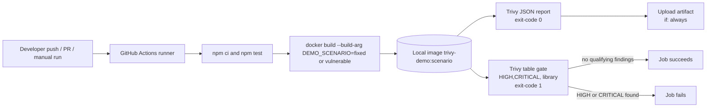

# DevSecOps Container Security Gate Using Trivy and Docker

> **Case study:** Integrating vulnerability scanning into a CI pipeline with Trivy, Docker and GitHub Actions.

## Verification status

This README separates what has been **verified** from what is **expected**.

| Item | Status |
|---|---|
| Unit tests (`npm test`, 13 tests) | **Verified locally** (all pass) |
| Fixed Docker image builds; `/health`, `/greet`, 404, non-root user, Docker health check | **Verified locally** |
| Vulnerable Docker image builds | **Verified locally** |
| Trivy scan of vulnerable image: CVE-2021-23337 and CVE-2026-4800 (HIGH, lodash 4.17.20); gate exit 1 | **Verified locally** (Trivy 0.76.0 container) |
| Trivy scan of fixed image: no HIGH/CRITICAL library findings; gate exit 0 | **Verified locally** (Trivy 0.76.0 container) |
| `scripts/demo.ps1` end to end | **Verified locally** (with a Trivy shim on PATH; see section 16) |
| GitHub Actions workflow run (vulnerable and fixed) | **Not yet verified.** The project has not been pushed to GitHub. |

## 1. Aim

To implement and demonstrate an automated DevSecOps security gate that scans Docker images for vulnerabilities and
blocks the pipeline when the configured threshold is violated.

## 2. Abstract

Container images bundle third-party libraries, and those libraries can contain known vulnerabilities. Manual scanning
does not stop a vulnerable image from moving through a delivery pipeline. This project builds a small Node.js HTTP
service into a Docker image and scans it with Trivy in GitHub Actions. The gate fails the job when a HIGH or CRITICAL
application-library vulnerability is found. A controlled `DEMO_SCENARIO` build argument produces one deliberately
vulnerable image (lodash 4.17.20) and one remediated image (lodash 4.18.1). The vulnerable image is expected to fail the
gate and the fixed image to pass it. The vulnerable image is for demonstration only and is never published.

## 3. Problem definition

Software that is built and deployed from container images inherits the vulnerabilities of every library it contains.
If there is no automated check, a vulnerable image can pass through CI and reach production. This project defines a
security threshold (HIGH and CRITICAL library vulnerabilities) and enforces it on every build.

## 4. Objectives

1. Develop a small, functional web application and package it in a Docker image.
2. Integrate Trivy vulnerability scanning into GitHub Actions.
3. Configure the pipeline to fail when HIGH or CRITICAL application-library vulnerabilities are detected.
4. Demonstrate both a failed security gate and a successful security gate after remediation.
5. Generate vulnerability reports and compare the vulnerable and remediated image versions.
6. Document the architecture, implementation, evaluation, limitations, and demonstration procedure.

## 5. Tool selection and justification

| Tool | Role | Why it was chosen |
|---|---|---|
| **Node.js 24** (built-in `node:http`, `node:test`) | Application runtime and test runner | Current runtime; no extra web framework or test dependency needed |
| **Lodash** | The single third-party library | Realistic dependency with documented HIGH vulnerabilities in older releases, so the gate can be demonstrated |
| **Docker** | Packaging | Reproducible image; the scanned artifact is the image, which is what gets deployed |
| **Trivy** (Aqua Security) | Vulnerability scanner | Free, widely used, scans image package metadata, and outputs JSON and table formats with severity filtering and exit codes |
| **GitHub Actions** | CI pipeline | Runs on GitHub-hosted runners with no extra infrastructure; supports manual runs with a `choice` input |
| **trivy-action** (`aquasecurity/trivy-action@v0.36.0`) | Trivy in CI | Official action with explicit inputs for scan type, vulnerability type, severity, format, and exit code |

## 6. Technologies and prerequisites

- Windows 10/11 with **PowerShell 5.1 or later**
- **Node.js 22 or later** and npm (developed with Node 22.18.0 and npm 10.9.3)
- **Docker Desktop** running with **Linux containers** (developed with Docker 29.3.1)
- **Git** (for pushing to GitHub)
- **Trivy CLI** (optional locally; see section 16)
- A **GitHub account** (only for the CI part)

## 7. Project directory structure

```
DEVOPS_Theory_IA/
├── .github/
│   └── workflows/
│       └── trivy-security-gate.yml   # CI pipeline with the Trivy gate
├── docs/
│   ├── before-after-comparison.md    # Vulnerable vs fixed comparison
│   ├── demo-script.md                # 5-7 minute video script
│   └── screenshot-checklist.md       # Screenshots to capture
├── scripts/
│   └── demo.ps1                      # Windows PowerShell demonstration script
├── src/
│   ├── app.js                        # HTTP server and routes
│   └── greet.js                      # Greeting and sanitization logic (Lodash)
├── tests/
│   └── app.test.js                   # node:test unit and HTTP tests
├── vulnerable/
│   ├── package.json                  # DEMO ONLY: lodash 4.17.20
│   └── package-lock.json             # Generated by npm
├── .dockerignore
├── .gitignore
├── Dockerfile                        # Multi-stage build with DEMO_SCENARIO build argument
├── package.json                      # Fixed configuration: lodash 4.18.1
├── package-lock.json                 # Generated by npm
└── README.md
```

`reports/` is created by the demo script and is git-ignored.

## 8. Architecture



## 9. CI pipeline explanation

File: `.github/workflows/trivy-security-gate.yml`

| Step | Purpose |
|---|---|
| Check out repository | `actions/checkout@v7.0.1` with `persist-credentials: false` |
| Set up Node.js 24 | `actions/setup-node@v7.1.0` with npm cache keyed on `package-lock.json` |
| Install fixed application dependencies | `npm ci` (uses the lockfile) |
| Run unit tests | `npm test` |
| Determine demonstration scenario | Manual runs use the `scenario` input; push and pull request runs always use `fixed` |
| Build Docker image | `docker build --build-arg DEMO_SCENARIO=<scenario> -t trivy-demo:<scenario> .` |
| Generate Trivy JSON report | `aquasecurity/trivy-action@v0.36.0`, `format: json`, `exit-code: '0'` |
| **Security gate** | `aquasecurity/trivy-action@v0.36.0`, `format: table`, `exit-code: '1'`, no `continue-on-error` |
| Upload report artifact | `actions/upload-artifact@v7.0.2` with `if: always()` and 14-day retention |

Triggers: `push` to `main`, `pull_request`, and `workflow_dispatch` with a `scenario` choice input (`fixed` default,
`vulnerable`).

## 10. Trivy and severity-based security gating

- **Scan type:** container image (`trivy image`).
- **Vulnerability type:** `library` only. This gates application dependencies (for example lodash in `node_modules`).
  OS-package findings are excluded by design, as the case study requires.
- **Severity:** `HIGH,CRITICAL`.
- **Scanners:** `vuln`.
- **Report step:** `exit-code: '0'` with JSON output, so the report is produced even when findings exist.
- **Gate step:** `exit-code: '1'` with table output. Trivy returns a non-zero code when a qualifying finding exists, and the job fails.
- The gate is not bypassed: there is no `continue-on-error`, no `|| true`, and no ignore file.
- `ignore-unfixed` is **not** set, so a HIGH finding with no available fix also fails the gate. This is the stricter choice.

## 11. Vulnerable versus fixed demonstration

| | Vulnerable (`DEMO_SCENARIO=vulnerable`) | Fixed (`DEMO_SCENARIO=fixed`, default) |
|---|---|---|
| lodash version | **4.17.20** (pinned in `vulnerable/package.json`) | **4.18.1** (pinned in `package.json`) |
| Lockfile | `vulnerable/package-lock.json` | `package-lock.json` |
| Verified Trivy findings | **CVE-2021-23337** (HIGH, fixed in 4.17.21) and **CVE-2026-4800** (HIGH, fixed in 4.18.0) | None (HIGH/CRITICAL library) |
| Expected gate result | **FAIL** (exit 1) | **PASS** (exit 0) |
| Verified locally | Yes: gate exit 1 | Yes: gate exit 0 |

**Why the vulnerable scenario fails.** lodash versions before 4.17.21 are affected by **CVE-2021-23337** (command
injection via `_.template`, rated HIGH with CVSS 7.2 in [GHSA-35jh-r3h4-6jhm](https://osv.dev/vulnerability/GHSA-35jh-r3h4-6jhm)).
Version 4.17.20 is in that range. Trivy also reports **CVE-2026-4800** for 4.17.20 (HIGH, fixed in 4.18.0). The gate fails.

**Why the fixed scenario passes.** The fixed configuration uses lodash **4.18.1**, which is at or above the fixed versions
of both CVEs. A Trivy scan of the fixed image reports no HIGH or CRITICAL library findings, so the gate returns 0.

**Why 4.17.21 was not used.** 4.17.21 fixes CVE-2021-23337, but a real scan of that image still reported CVE-2026-4800
(HIGH, fixed in 4.18.0), so the gate would still have failed. Scanning, not assumption, chose 4.18.1.

**Npm tooling in the base image.** The first fixed scan also reported HIGH findings in npm's own bundled packages
(`brace-expansion`, `undici`, `http-cache-semantics`) from the Node base image. The runtime stage now removes npm, npx and
corepack, which the service does not need. Those findings no longer appear in the fixed scan.

**Safety.** The vulnerable image exists only for this controlled demonstration. It is not pushed, published, or deployed.

## 12. Setup and execution (Windows PowerShell)

Run all commands from the project folder:

```powershell
cd C:\Users\ayush\Downloads\DEVOPS_Theory_IA
npm ci
```

`npm ci` installs the exact versions in `package-lock.json` (the fixed configuration).

## 13. Running the application locally

```powershell
npm start
```

In a second PowerShell window:

```powershell
Invoke-RestMethod http://localhost:3000/
Invoke-RestMethod http://localhost:3000/health
Invoke-RestMethod "http://localhost:3000/greet?name=%20%20Ada%20%20Lovelace%20%20"
```

Expected responses:

- `/` returns the application name, version, description, and endpoint list (HTTP 200).
- `/health` returns `{"status":"ok","uptimeSeconds":...}` (HTTP 200).
- `/greet?name=...` returns `{"name":"Ada Lovelace","message":"Hello, Ada Lovelace!"}` (HTTP 200). Leading and trailing
  whitespace is trimmed and internal whitespace is collapsed. A missing or blank name becomes `World`.
- Any unknown route returns `{"error":"Not Found",...}` with HTTP 404.

The port defaults to `3000`. Override it with `$env:PORT = 8080` before `npm start`. Stop the server with `Ctrl+C`.

## 14. Building and running the Docker image

Make sure Docker Desktop is running in Linux container mode.

Build the fixed image (default scenario):

```powershell
docker build --build-arg DEMO_SCENARIO=fixed -t trivy-demo:fixed .
```

Run it and check the health endpoint:

```powershell
docker run -d --name trivy-demo-fixed -p 3000:3000 trivy-demo:fixed
Start-Sleep -Seconds 8
Invoke-RestMethod http://localhost:3000/health
docker inspect --format '{{.State.Health.Status}}' trivy-demo-fixed   # expect: healthy
docker rm -f trivy-demo-fixed
```

Unsupported scenario values fail the build with a clear message:

```powershell
docker build --build-arg DEMO_SCENARIO=bogus -t trivy-demo:bogus .
# ERROR: unsupported DEMO_SCENARIO='bogus'. Allowed values: fixed, vulnerable.
```

The image runs as the non-root user `app` and contains no secrets. The vulnerable image is built only for the scan and
should not be run outside the demonstration:

```powershell
docker build --build-arg DEMO_SCENARIO=vulnerable -t trivy-demo:vulnerable .
```

## 15. Running the unit tests

```powershell
npm test
```

The tests use only `node:test` and `node:assert/strict`. They cover greeting sanitization (trimming, internal whitespace,
empty and whitespace-only input, missing or non-string values, length truncation) and the HTTP endpoints (`/`, `/health`,
`/greet`, the default name, 404, and 405).

## 16. Running the Trivy demonstration script

```powershell
powershell -ExecutionPolicy Bypass -File .\scripts\demo.ps1
```

The script:

1. Checks that Docker is running with Linux containers.
2. Runs `npm test`.
3. Builds `trivy-demo:vulnerable` and `trivy-demo:fixed`.
4. If the **Trivy CLI** is on PATH, writes JSON reports to `reports/` and checks the gate. The vulnerable image must fail
   the gate and the fixed image must pass it. An expected failure is reported as `[PASS]`, not as a script error.
5. If the Trivy CLI is **not** installed, it says so explicitly: the scans were not run and the gate is not verified
   locally. It then exits 0 with a "partial demo" message and points to the GitHub Actions instructions.

Exit codes: `0` when every executed check matched its expectation, `1` for an unexpected outcome or script error.

**Installing Trivy (optional).** Follow the official [Trivy installation guide](https://trivy.dev/docs/latest/getting-started/installation/)
if you want the script to run the scans on this machine. This project does not install Trivy or change machine-wide settings.

**Verification note.** The script was run end to end on the development machine. Trivy was not installed as a native CLI, so a
temporary shim that runs the official `aquasec/trivy:0.76.0` container was placed on PATH for that process only. Both expected
outcomes were confirmed and the script exited 0.

## 17. Pushing the project to GitHub and enabling Actions

Nothing has been pushed. Do this only when you are ready. Create an empty repository on GitHub first, then run:

```powershell
cd C:\Users\ayush\Downloads\DEVOPS_Theory_IA
git init
git add .
git commit -m "Add Trivy container security gate demo"
git branch -M main
git remote add origin https://github.com/<your-user>/<your-repo>.git
git push -u origin main
```

Replace `<your-user>` and `<your-repo>`. Git will ask you to sign in to GitHub (for example through Git Credential
Manager). Do not write tokens into project files. `node_modules/`, `vulnerable/node_modules/` and `reports/` are
git-ignored and are not committed.

Enable Actions:

1. Open the repository on GitHub, then **Settings > Actions > General**.
2. Under **Actions permissions**, allow actions (GitHub and verified actions are allowed by default).
3. Open the **Actions** tab. The **Trivy Security Gate** workflow appears once the file is on the default branch.

## 18. Running the workflow manually (vulnerable and fixed)

1. Open the **Actions** tab and select **Trivy Security Gate**.
2. Click **Run workflow** and keep the branch as `main`.
3. Choose **scenario**:
   - `vulnerable`: expect the **Security gate** step to fail (exit code 1) and the job to be marked failed.
   - `fixed`: expect the **Security gate** step to pass and the job to succeed.
4. After each run, open it and download the artifact `trivy-report-vulnerable` or `trivy-report-fixed`.

Pushes to `main` and pull requests always build the `fixed` scenario and are expected to pass.

## 19. Expected results

| Scenario | Trivy findings (HIGH/CRITICAL, library) | Gate step | Job result | Verified? |
|---|---|---|---|---|
| Local, `vulnerable` | 2 HIGH: CVE-2021-23337, CVE-2026-4800 (lodash) | exit 1 | Fails as designed | **Yes** (local Trivy 0.76.0) |
| Local, `fixed` | 0 | exit 0 | Passes | **Yes** (local Trivy 0.76.0) |
| GitHub, `vulnerable` (manual) | Expected: the same 2 | Expected to fail | Expected failed | **Pending** (not run on GitHub) |
| GitHub, `fixed` (manual or push) | Expected: 0 | Expected to pass | Expected success | **Pending** (not run on GitHub) |

## 20. Downloading and interpreting the scan report

1. In the workflow run, scroll to **Artifacts** and download `trivy-report-vulnerable` or `trivy-report-fixed`
   (kept for 14 days).
2. Open the JSON file in VS Code. Key fields:
   - `Results[]`: one entry per scanned target (for example `app/package.json`).
   - `Results[].Vulnerabilities[]`: each finding with `VulnerabilityID` (CVE), `PkgName`, `InstalledVersion`,
     `FixedVersion`, `Severity`, `Title` and `PrimaryURL`.
3. `FixedVersion` is the minimum version that resolves the issue. An empty value means no fix is available yet.

Example from the local vulnerable scan:

```json
{
  "VulnerabilityID": "CVE-2021-23337",
  "PkgName": "lodash",
  "InstalledVersion": "4.17.20",
  "FixedVersion": "4.17.21",
  "Severity": "HIGH"
}
```

Count findings in PowerShell:

```powershell
$r = Get-Content .\reports\trivy-report-vulnerable.json -Raw | ConvertFrom-Json
$r.Results | ForEach-Object { $_.Vulnerabilities } | Where-Object { $_ } | Group-Object Severity | Select-Object Name, Count
```

## 21. Before-and-after evaluation

See [docs/before-after-comparison.md](docs/before-after-comparison.md). Verified local results:

| Metric | Vulnerable | Fixed |
|---|---|---|
| lodash version | 4.17.20 | 4.18.1 |
| HIGH findings | 2 | 0 |
| CRITICAL findings | 0 | 0 |
| Gate result | Failed (exit 1) | Passed (exit 0) |

GitHub Actions results are pending until the workflow has run on GitHub.

## 22. Security benefits and practical use cases

- **Shift-left enforcement:** vulnerable images are stopped in CI, before they reach a registry or an environment.
- **Repeatable:** the same threshold and report apply to every build; the manual `scenario` input makes the check easy to demonstrate.
- **Evidence:** the JSON artifact is an auditable record of findings and fixed versions.
- **Least privilege in the image:** the runtime runs as a non-root user, has no npm tooling, and holds no secrets.
- **Practical use:** any containerized service can add the same gate. Teams can tune the severity threshold or add a reviewed exception list.

## 23. Limitations and possible improvements

- **CI not yet executed:** the GitHub Actions workflow has not run on GitHub. Its results are pending.
- **Database dependency:** findings depend on the Trivy vulnerability database at scan time, so a later scan may differ.
- **Library scope:** only `--vuln-type library` is gated. OS package findings are not gated, by design.
- **Unfixed vulnerabilities:** `ignore-unfixed` is not set, so a HIGH finding with no fix also fails the gate. Teams may prefer to ignore those.
- **No SBOM or image signing:** Trivy can produce SBOMs and images can be signed, but neither is part of this demo.
- **Single application:** real projects need a reviewed exception process (for example a `.trivyignore` file) for accepted risks.
- **Local gate needs Trivy:** `demo.ps1` verifies the gate only when the Trivy CLI is available.

Possible improvements: make `ignore-unfixed` configurable, generate and sign an SBOM, push only images that pass the gate,
and schedule regular scans of published images.

## 24. Conclusion

The project shows that a Trivy severity gate can block a container image containing known HIGH library vulnerabilities
(lodash 4.17.20: CVE-2021-23337 and CVE-2026-4800). The same pipeline passes after remediation to a version verified by
scanning (lodash 4.18.1). The local scans confirm both expected outcomes. The GitHub Actions run must still be executed on
GitHub to complete the cloud demonstration.

## 25. References

- Trivy documentation: installation: <https://trivy.dev/docs/latest/getting-started/installation/>
- Trivy documentation: container image scanning: <https://trivy.dev/docs/latest/target/container_image/>
- Trivy GitHub Action (aquasecurity/trivy-action): <https://github.com/aquasecurity/trivy-action>
- GitHub Actions: workflow syntax and `workflow_dispatch`: <https://docs.github.com/en/actions/using-workflows/workflow-syntax-for-github-workflows>
- GitHub Actions: storing workflow artifacts: <https://docs.github.com/en/actions/using-workflows/storing-workflow-data-as-artifacts>
- Docker documentation: multi-stage builds: <https://docs.docker.com/build/building/multi-stage/>
- Docker documentation: Dockerfile `ARG`: <https://docs.docker.com/reference/dockerfile/#arg>
- Node.js documentation: test runner (`node:test`): <https://nodejs.org/api/test.html>
- Node.js documentation: HTTP server (`node:http`): <https://nodejs.org/api/http.html>
- OSV entry for CVE-2021-23337 (GHSA-35jh-r3h4-6jhm): <https://osv.dev/vulnerability/GHSA-35jh-r3h4-6jhm>
- NIST National Vulnerability Database, CVE-2021-23337: <https://nvd.nist.gov/vuln/detail/CVE-2021-23337>
- Lodash project: <https://lodash.com/>
